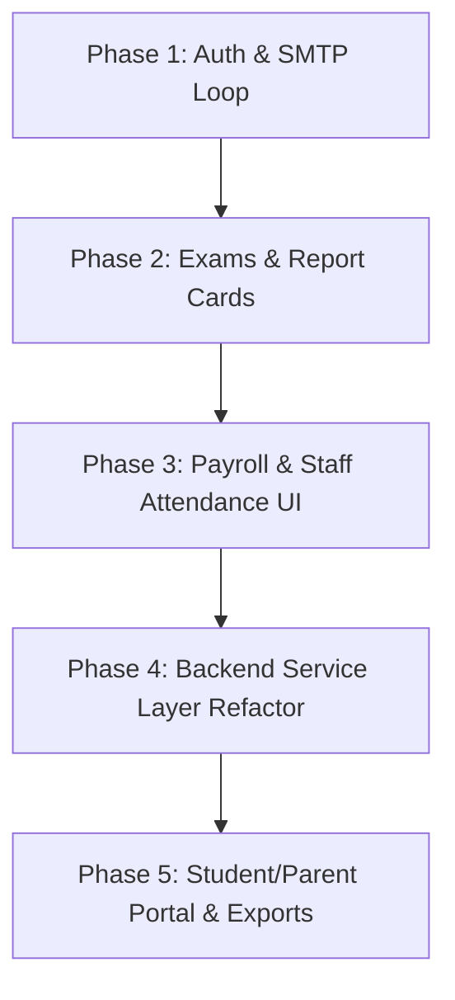

# 🏫 Comprehensive ERP System Audit & Centralization Roadmap

**Project:** School ERP System (`erp-be` & `erp-fe`)  
**Date:** October 2026  
**Status:** Audit & Action Plan Document  

---

## 📌 Executive Summary

This document provides a complete audit of the ERP system across all layers:
1. **Architecture Level** (Centralization, System Design & Infrastructure)
2. **Code Level** (Coding Rules, Reusability, Structure & Type Safety)
3. **Functionality Level** (Core ERP Modules & Business Logic)
4. **UI / UX Level** (Frontend Components, Routing & User Experience)
5. **SMTP & Notifications Level** (Email Automation & Communication)

Each section categorizes features into:
- ✅ **Done (Completed & Functional)**
- 🟡 **In Progress / Partially Done**
- 🔴 **Remaining / Incomplete (Action Required)**

---

## 1. 🏛️ Architecture Level

### ✅ Done
- **Client-Server Architecture**: Clean separation between `erp-be` (Node.js/Express/Sequelize) and `erp-fe` (React/Vite/Tailwind).
- **Centralized Security Layer**:
  - Stateless short-lived JWT access tokens + HTTP-only refresh tokens.
  - Granular RBAC (Role-Based Access Control) with server-side encrypted permission payload delivery.
  - Real-time permission updates and invalidations using Socket.io (`permissionEmitter.js`).
  - Rate limiting, CORS whitelist, Helmet protection, and centralized logging via Winston/Morgan.
- **Master School Entity**: Centralized `SchoolConfig` table providing branding, logo, affiliations, addresses, and contacts across all system modules.

### 🟡 In Progress / Partially Done
- **Controller-Service Layer Separation**: While `email.service.js` and `permissionService.js` exist, controllers (`admission.controller.js`, `studentController.js`, `classroomController.js`) still hold heavy ORM queries and business logic directly instead of delegating to domain services.
- **Multi-Tenant / Branch Readiness**: Database models are currently configured for a single school instance. Multi-branch or academic session separation needs a unified context switch.

### 🔴 Remaining / Incomplete
- **Global System Audit Log**: Currently only `PermissionAuditLog` exists. Need a centralized `SystemAuditLog` tracking all critical actions (salary slip approvals, marks modifications, student status changes).
- **Background Task / Worker Queue (BullMQ / Redis)**: Asynchronous tasks like bulk emailing, report card generation, and attendance batch sync run directly on the Express request cycle. A queue system is required for enterprise scalability.

---

## 2. 💻 Code Level

### ✅ Done
- **Standardized API Response Structure**: Every endpoint returns `{ success: boolean, message: string, data: any, error?: any }` using `apiResponse.js`.
- **Backend Schema Validation**: Input validation implemented using Zod across critical routes (`schoolConfig.validator.js`, student, classroom routes).
- **Frontend State Separation**:
  - Global UI & Auth: Redux Toolkit + `redux-persist`.
  - Server Data Cache: `@tanstack/react-query` used throughout.

### 🟡 In Progress / Partially Done
- **Database Transactions (`sequelize.transaction`)**: Present in student enrollment and admissions, but missing in multiple batch assignments, marks updates, and bulk attendance upserts.
- **Code Duplication in Controllers**: Pagination and search logic repeated across multiple controllers instead of using a shared `BaseRepository` or pagination helper.

### 🔴 Remaining / Incomplete
- **Backend TypeScript Migration**: Backend is written in ES6 JavaScript (`.js`). Project standards require TypeScript across both frontend and backend for strict type safety (`any` avoidance).
- **Automated Testing Suite**: Missing Unit/Integration tests for sensitive operations (salary deductions, grade calculations, permission resolvers).

---

## 3. ⚙️ Functionality Level

| Module | Status | What is Done | What is Remaining / In Progress |
| :--- | :---: | :--- | :--- |
| **Authentication & Accounts** | ✅ **100%** | JWT login, lockout after 5 failed attempts, refresh rotation, user CRUD, avatar upload, live Forgot Password & Reset Password token flow. | Request Access backend email notification hook. |
| **RBAC & Permissions** | ✅ **95%** | Roles, permissions matrix, real-time WebSocket permission revocation, dynamic client UI gatekeeping. | Fine-grained field-level permissions (e.g. read salary vs edit salary). |
| **School Configuration** | ✅ **90%** | Core school info, contact details, logo and watermark upload/storage. | Dynamic SMTP credentials setup directly via configuration screen. |
| **Classrooms & Timetable** | ✅ **90%** | Sections, classes, subjects, teacher allocations, period management, interactive timetable grid. | Teacher clash detection across multiple classrooms. |
| **Students & Guardians** | ✅ **90%** | Full directory, personal profiles, guardian records, document tracking, classroom enrollment. | Transfer Certificate (TC) generation, student ID card printable generator. |
| **Admissions (Public)** | ✅ **100%** | Expiring admission tokens, aligned `/public/admissions/:token` route, parent multi-step form, approval/rejection with auto-student creation. | Application fee payment gateway integration. |
| **Student Attendance** | 🟡 **70%** | Daily attendance grid, month/day filters, attendance statistics. | Parent leave application requests, automated absence SMS/Email dispatch. |
| **Staff Attendance** | 🟡 **65%** | Backend `TeacherAttendance` model, check-in/out hour computation, monthly summaries. | **Frontend UI missing** (No screen to mark or view teacher attendance). |
| **Examinations & Grading** | 🟡 **50%** | Backend `Exam`, `ExamSchedule`, `ExamResult` models, gradebook in classroom details, student marks view. | **Automated calculations (Percentages & Letter Grades A+, B, etc.)**, **Draft vs Published mode**, **PDF Report Card generation**, Excel Bulk Import. |
| **Payroll & Salaries** | 🟡 **40%** | Backend `salaryController.js` calculating daily/hourly deductions based on attendance. | **No Frontend UI** — Missing salary dashboard, payslip generation, and teacher payment history screens. |
| **Events & Calendar** | ✅ **85%** | Institutional calendar view, event types, event creation and management dialogs. | Auto-syncing exam schedules and academic holidays into the main calendar. |

---

## 4. 🎨 UI / UX Level

### ✅ Done
- **Modern Design System**: Shadcn/Radix UI with Tailwind CSS, custom dark/light theme, and `sonner` notifications.
- **Responsive Navigation**: Collapsible desktop sidebar, mobile drawer, scroll-sensitive breadcrumb bar.
- **Granular UI Guarding**: Navigation items filtered based on `can(resource, action)`.
- **Comprehensive Entity Pages**: High-density dashboards for Students, Classrooms, Homework, and Users.
- **Complete Auth Flow**: Login, Forgot Password, Reset Password, and Request Access UI fully styled and wired.

### 🟡 In Progress / Partially Done
- **Missing Sidebar Links & Pages**:
  - **Payroll & Salary Management**: Missing from sidebar and route registry.
  - **Staff Attendance Tracking**: Missing from sidebar and route registry.
- **Form Error Feedback**: Some dialogs lack standardized `react-hook-form` + Zod schema error labels.

### 🔴 Remaining / Incomplete
- **Dedicated Student / Parent Portal**: Currently, UI caters to Admin and Teachers. Needs a tailored portal dashboard for students/parents (viewing personal attendance, timetable, results, homework submissions).
- **Print & Export Engine**: Print stylesheets and printable templates for Student ID Cards, Report Cards, and Salary Slips.

---

## 5. 📧 SMTP & Email Notification System

### ✅ Done
- **Centralized Email Engine**: Centralized in `email.service.js` using `nodemailer`.
- **Dynamic School Context & Production URLs**: Automatically injects school name, phone, email, and address, and builds asset URLs using `BACKEND_URL` / `FRONTEND_URL`.
- **Active Operational Templates**:
  - Admission application received email.
  - Admission approved email with auto-generated portal login credentials.
  - Admission rejected email with customizable rejection reasons.
  - **Password reset request template & live link handling**.

### 🟡 In Progress / Partially Done
- **SMTP Credential Centralization**: Currently reads `SMTP_USER` and `SMTP_PASSWORD` only from backend `.env`. Needs to support database-driven SMTP settings configured via the UI.

### 🔴 Remaining / Incomplete
- **Password Reset Integration**: `sendPasswordResetEmail` is ready, but `/api/auth/forgot-password` route and frontend form are not linked.
- **Event-Driven Automated Emails**:
  - Absence alert emails to parents when attendance is marked absent.
  - Homework assignment notifications to students.
  - Salary slip PDFs sent directly to teacher emails at month-end.

---

## 🚀 Recommended Phase-wise Roadmap

### 1. Phase 1: Complete Auth & SMTP Loop
- Add `/api/auth/forgot-password` and `/api/auth/reset-password` endpoints.
- Connect frontend `ForgotPassword.tsx` to dispatch `sendPasswordResetEmail`.
- Add SMTP Settings tab inside `SchoolConfigPage` so administrators can configure email credentials directly from the UI.

### 2. Phase 2: Examination & Report Card System
- Add automated calculations (Total marks, percentages, letter grades A+, A, B, etc.).
- Add "Draft" vs "Published" toggle for exam marks.
- Build printable & downloadable PDF Report Cards with school logo & watermark.
- Add Excel bulk import for marks entry.

### 3. Phase 3: Staff Attendance & Payroll UI
- Build the Staff Attendance management interface.
- Build the Payroll & Salary Dashboard (calculating gross/net salary, absent deductions, generating salary slips).
- Register Payroll & Staff Attendance in `Sidebar.tsx` with proper RBAC guards.

### 4. Phase 4: Backend Service Refactoring
- Move business logic out of controllers into dedicated domain services:
  - `student.service.js`
  - `exam.service.js`
  - `classroom.service.js`
  - `salary.service.js`
- Wrap all multi-step database writes in `sequelize.transaction`.

### 5. Phase 5: Student/Parent Portal & Printable Exports
- Build simplified, role-specific views for students and parents.
- Add print-friendly stylesheets for Fee receipts, Student ID cards, and Timetables.
