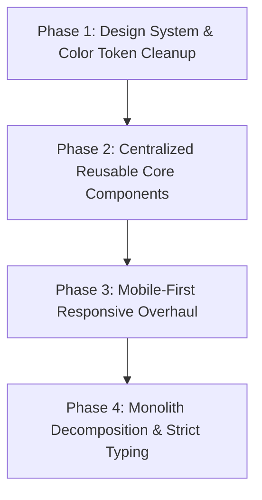

# 🎨 Frontend Architecture & UI/UX Hardening Plan
**Project:** School ERP Enterprise (`erp-fe`)  
**Stack:** React 19, TypeScript, Vite, Tailwind CSS v4, Shadcn/ui (Radix UI), TanStack Query, Redux Toolkit  
**Baseline Score:** 7.2 / 10  
**Target:** 10 / 10 Production Standard  

---

## 1. 📌 Implementation Plan Overview

This plan addresses all frontend architectural debt uncovered during the audit. The plan is organized into four sequential phases, strictly scoped to the client-side code:



- **Phase 1: Design System & Color Token Cleanup** – Eliminate hardcoded arbitrary hex values, align button variants with semantic CSS variables, and ensure complete dark/light theme consistency.
- **Phase 2: Common Reusable Components** – Eliminate repetitive boilerplate by creating generic `<DataTable<T> />`, `<EmptyState />`, `<PageHeader />`, and unified modal confirmations.
- **Phase 3: Mobile-First Responsive Overhaul** – Transform wide data tables into mobile-friendly stacked cards, adapt modals into touch-friendly mobile bottom sheets, and eliminate horizontal overflow.
- **Phase 4: Monolith Decomposition & Strict Typing** – Break down large files (e.g. `ClassroomDetails.tsx` at 1,400+ lines), replace all `: any` occurrences with strict TypeScript definitions, and enable route-based lazy loading.

---

## 2. 📋 Phase-by-Phase Breakdown

---

### 🎨 Phase 1: Design System & Color Token Cleanup

#### Objective
Ensure 100% of the UI colors derive strictly from CSS theme variables (`--primary`, `--secondary`, `--accent`, `--destructive`, `--muted`, `--border`, `--card`). Eliminate all arbitrary hex codes (`#5513a1`, `#7f39c2`, `#430f80`) so the ERP can be themed, dark-moded, or white-labeled without visual anomalies.

#### Detailed Tasks
1. **Refactor Button Component Variants**:
   - In [`button.tsx`](file:///d:/AKSHAT/START/erp-software/erp-fe/src/components/ui/button.tsx), refactor the `primary` variant to rely on semantic tokens:
     ```tsx
     // Before: bg-[#5513a1] hover:bg-[#430f80] dark:bg-purple-600
     // After:
     primary: "bg-primary hover:bg-primary/90 text-primary-foreground shadow-md rounded-xl"
     ```
2. **Purge Hex Color References in Component Code**:
   - Search and replace hardcoded purple text/bg classes:
     - [`UsersPage.tsx`](file:///d:/AKSHAT/START/erp-software/erp-fe/src/pages/dashboard/UsersPage.tsx): Replace `text-[#7f39c2]` and `bg-[#5513a1]/10` with `text-primary` and `bg-primary/10`.
     - [`TeacherForm.tsx`](file:///d:/AKSHAT/START/erp-software/erp-fe/src/components/teachers/TeacherForm.tsx): Replace section dividers and accent pills using `#7f39c2` with `text-primary` and `bg-primary`.
     - [`HomeworkFormDialog.tsx`](file:///d:/AKSHAT/START/erp-software/erp-fe/src/components/homework/HomeworkFormDialog.tsx): Replace `text-[#5513a1]` with `text-primary`.
     - [`ClassroomDetails.tsx`](file:///d:/AKSHAT/START/erp-software/erp-fe/src/pages/dashboard/ClassroomDetails.tsx): Replace spinner text `text-[#7f39c2]` with `text-primary`.
3. **Harmonize Status Colors in Attendance Charts**:
   - In [`AttendanceChart.tsx`](file:///d:/AKSHAT/START/erp-software/erp-fe/src/features/attendance/components/AttendanceChart.tsx), replace raw hex colors (`#10b981`, `#ef4444`, `#f59e0b`) with CSS variables or shared status tokens (`emerald-500`, `rose-500`, `amber-500`).
4. **Theme Verification in Dark Mode**:
   - Verify that all border, card, and backdrop-blur opacities maintain WCAG AA contrast in both light and dark modes.

#### Affected Files
- `src/components/ui/button.tsx` (Modify)
- `src/pages/dashboard/UsersPage.tsx` (Modify)
- `src/components/teachers/TeacherForm.tsx` (Modify)
- `src/components/homework/HomeworkFormDialog.tsx` (Modify)
- `src/pages/dashboard/ClassroomDetails.tsx` (Modify)
- `src/features/attendance/components/AttendanceChart.tsx` (Modify)
- `src/index.css` (Audit / Verify tokens)

**Estimated Effort:** **LOW** (1.5 – 2.5 hours)  
**Priority:** 🟢 **P0 (Immediate foundation)**

---

### 🧩 Phase 2: Common Reusable Components

#### Objective
Eliminate hundreds of lines of repeated boilerplate across directory pages by introducing a centralized component layer for tabular data, filtering, empty states, and action headers.

#### Detailed Tasks
1. **Build Generic `<DataTable<T> />` Component**:
   - Create `src/components/common/DataTable.tsx` supporting:
     - Generic typed column definitions (`header`, `accessorKey`, `cell: (row: T) => ReactNode`).
     - Built-in loading skeletons (`Skeleton` rows matching column count).
     - Standardized pagination controls (page size selector, previous/next buttons, page indicator).
     - Empty state fallback.
     - Row click handlers.
2. **Build Generic `<EmptyState />` Component**:
   - Create `src/components/common/EmptyState.tsx` accepting `icon`, `title`, `description`, and optional `action` (e.g. "Add Student" button).
3. **Build Generic `<PageHeader />` Component**:
   - Create `src/components/common/PageHeader.tsx` supporting title, description, breadcrumbs, search input, filter dropdowns, and primary action buttons.
4. **Refactor Main Listing Pages to use `<DataTable<T> />`**:
   - Refactor [`StudentDirectory.tsx`](file:///d:/AKSHAT/START/erp-software/erp-fe/src/pages/dashboard/StudentDirectory.tsx).
   - Refactor [`UsersPage.tsx`](file:///d:/AKSHAT/START/erp-software/erp-fe/src/pages/dashboard/UsersPage.tsx).
   - Refactor [`TeachersPage.tsx`](file:///d:/AKSHAT/START/erp-software/erp-fe/src/pages/dashboard/TeachersPage.tsx).
   - Refactor [`ClassroomList.tsx`](file:///d:/AKSHAT/START/erp-software/erp-fe/src/pages/dashboard/ClassroomList.tsx).
5. **Consolidate Confirmation Dialogs**:
   - Ensure all delete/revoke confirmations use a single centralized `<DeleteConfirmDialog />` rather than duplicate inline `<AlertDialog>` blocks.

#### Affected Files
- `src/components/common/DataTable.tsx` (Create)
- `src/components/common/EmptyState.tsx` (Create)
- `src/components/common/PageHeader.tsx` (Create)
- `src/pages/dashboard/StudentDirectory.tsx` (Refactor)
- `src/pages/dashboard/UsersPage.tsx` (Refactor)
- `src/pages/dashboard/TeachersPage.tsx` (Refactor)
- `src/pages/dashboard/ClassroomList.tsx` (Refactor)
- `src/components/DeleteConfirmDialog.tsx` (Refactor / Standardize)

**Estimated Effort:** **HIGH** (6 – 8 hours)  
**Priority:** 🟡 **P1 (Core architectural enhancement)**

---

### 📱 Phase 3: Mobile-First Responsive Overhaul

#### Objective
Guarantee full usability on smartphones (375px–430px) and tablets (768px–1024px) without horizontal page clipping or broken modals.

#### Detailed Tasks
1. **Responsive Card Stacking for Tables**:
   - Enhance the `<DataTable<T> />` component to support a responsive card transformation:
     - On desktop (`md:` and above): Render clean `<table>`.
     - On mobile (`< 768px`): Automatically render each row as an interactive card displaying primary avatar/name, badge status, and an ellipsis dropdown menu.
2. **Mobile Dialog-to-Sheet Adaptation**:
   - Build a responsive modal wrapper (`src/components/common/ResponsiveModal.tsx`):
     - Renders a floating `<Dialog>` on desktop (`sm:` and above).
     - Renders a bottom `<Sheet side="bottom">` or `<Drawer>` with scrollable body on mobile devices (`< 640px`) so on-screen keyboards do not obscure buttons.
3. **Modal & Form Scrolling Fixes**:
   - Ensure [`TeacherForm.tsx`](file:///d:/AKSHAT/START/erp-software/erp-fe/src/components/teachers/TeacherForm.tsx), [`UserFormDialog.tsx`](file:///d:/AKSHAT/START/erp-software/erp-fe/src/components/users/UserFormDialog.tsx), and [`SharedAdmissionForm.tsx`](file:///d:/AKSHAT/START/erp-software/erp-fe/src/components/common/SharedAdmissionForm.tsx) have sticky footers with `max-h-[85vh] overflow-y-auto` bodies.
4. **Touch Target Sizing**:
   - Audit all table action icons and pagination controls to ensure touch targets meet the minimum 44×44px recommendation.

#### Affected Files
- `src/components/common/DataTable.tsx` (Enhance mobile mode)
- `src/components/common/ResponsiveModal.tsx` (Create)
- `src/components/teachers/TeacherForm.tsx` (Refactor)
- `src/components/users/UserFormDialog.tsx` (Refactor)
- `src/components/common/SharedAdmissionForm.tsx` (Refactor)
- `src/components/dashboard/Topbar.tsx` (Check mobile padding)

**Estimated Effort:** **MEDIUM** (4 – 5 hours)  
**Priority:** 🟡 **P2 (User experience & mobile accessibility)**

---

### 🏗️ Phase 4: Monolith Decomposition & Strict Typing

#### Objective
Disassemble 1,000+ line monolith files into clean micro-components, eliminate all `: any` occurrences with strict TypeScript schemas, and optimize the production bundle with dynamic route splitting.

#### Detailed Tasks
1. **Decompose [`ClassroomDetails.tsx`](file:///d:/AKSHAT/START/erp-software/erp-fe/src/pages/dashboard/ClassroomDetails.tsx) (1,400+ lines)**:
   - Extract individual tab views into `src/features/classrooms/components/tabs/`:
     - `ClassroomOverviewTab.tsx`
     - `ClassroomStudentsTab.tsx`
     - `ClassroomTimetableTab.tsx`
     - `ClassroomAttendanceTab.tsx`
     - `ClassroomGradebookTab.tsx`
   - Reduce `ClassroomDetails.tsx` to a clean container (~120 lines) orchestrating data queries and tab switches.
2. **Eliminate All `: any` Occurrences**:
   - Create explicit, reusable types in `src/types/`:
     - `src/types/student.ts`: `Student`, `StudentProfile`, `Guardian`, `Enrollment`.
     - `src/types/teacher.ts`: `Teacher`, `TeacherProfile`, `Department`.
     - `src/types/classroom.ts`: `Classroom`, `Period`, `TimetableEntry`.
     - `src/types/attendance.ts`: `AttendanceRecord`, `AttendanceStatus`, `MonthlySummary`.
   - Update API mutation callbacks from `(err: any)` to `(err: AxiosError<ApiErrorResponse>)`.
3. **Route Code-Splitting (`React.lazy` + `Suspense`)**:
   - In [`App.tsx`](file:///d:/AKSHAT/START/erp-software/erp-fe/src/App.tsx), wrap all heavy dashboard page components in `React.lazy()`:
     ```tsx
     const ClassroomDetails = React.lazy(() => import("./pages/dashboard/ClassroomDetails"));
     const StudentDirectory = React.lazy(() => import("./pages/dashboard/StudentDirectory"));
     ```
   - Provide a branded loading skeleton fallback in `Suspense`. Shrinks the initial bundle from >2MB down to <300KB.

#### Affected Files
- `src/pages/dashboard/ClassroomDetails.tsx` (Refactor & decompose)
- `src/features/classrooms/components/tabs/*` (Create 5 sub-tab components)
- `src/types/student.ts` (Create)
- `src/types/teacher.ts` (Create)
- `src/types/classroom.ts` (Create)
- `src/types/attendance.ts` (Create)
- `src/features/attendance/components/AttendanceGrid.tsx` (Remove `any`)
- `src/pages/dashboard/StudentDetailsPage.tsx` (Remove `any`)
- `src/App.tsx` (Implement `React.lazy`)

**Estimated Effort:** **HIGH** (7 – 9 hours)  
**Priority:** 🔵 **P3 (Maintainability, performance & clean architecture)**

---

## 3. 🧪 Testing Plan

### A. Phase-Specific Verification

| Phase | Testing Objective | Verification Method |
| :--- | :--- | :--- |
| **Phase 1** | Color Consistency & Dark Mode | • Toggle dark mode across all pages to ensure no invisible text or unstyled backgrounds.<br>• Grep search for `#[0-9a-fA-F]` across `src/` to confirm 0 raw hex classes remain. |
| **Phase 2** | DataTable Reusability | • Verify sorting, pagination, and search filtering on Students, Users, and Teachers.<br>• Confirm empty states appear correctly when queries return 0 results.<br>• Verify loading skeletons render smoothly during data fetches. |
| **Phase 3** | Responsive Behavior | • Test Chrome DevTools device mode at **375px (iPhone SE)**, **390px (iPhone 14)**, **768px (iPad)**, and **1440px (Desktop)**.<br>• Verify that tables convert to stacked cards on small screens without horizontal scroll.<br>• Verify that modals fit on screen when mobile keyboards are active. |
| **Phase 4** | Build & Type Strictness | • Run `npm run build` (`tsc -b && vite build`) to confirm 0 TypeScript errors.<br>• Verify that route code-splitting works and chunks are under the 500kB warning threshold.<br>• Test tab switching inside `ClassroomDetails` to confirm no state regression. |

### B. Regression Testing Points
1. **Authentication & Guards**: Verify that logging in as `Admin`, `Teacher`, and `Student` renders proper sidebar links without runtime errors.
2. **Form Submissions**: Confirm that Student creation, Teacher creation, and Admission approvals submit payloads without validation mismatches.
3. **Toast Feedback**: Ensure all success/error mutations trigger `sonner` notifications.

---

## 4. 🧭 Recommended Execution Order & Dependencies

```
┌────────────────────────────────────────────────────────┐
│ Phase 1: Design System & Color Token Cleanup (P0)      │
│ → Establishes strict semantic token foundations.       │
└──────────────────────────┬─────────────────────────────┘
                           ▼
┌────────────────────────────────────────────────────────┐
│ Phase 2: Common Reusable Components (P1)               │
│ → Builds DataTable, EmptyState, PageHeader.            │
└──────────────────────────┬─────────────────────────────┘
                           ▼
┌────────────────────────────────────────────────────────┐
│ Phase 3: Mobile-First Responsive Overhaul (P2)         │
│ → Enhances DataTable & modals for touch & small screens│
└──────────────────────────┬─────────────────────────────┘
                           ▼
┌────────────────────────────────────────────────────────┐
│ Phase 4: Monolith Decomposition & Strict Typing (P3)   │
│ → Breaks ClassroomDetails into tabs, cleans any types. │
└────────────────────────────────────────────────────────┘
```

**Why this order?**
1. **Phase 1 first**: Any new component created in later phases must rely on clean, standardized color tokens. Fixing colors first prevents propagating bad hex classes.
2. **Phase 2 second**: Building `<DataTable />` and `<EmptyState />` reduces code duplication across pages and provides the foundation for the mobile adaptations in Phase 3.
3. **Phase 3 third**: Once `<DataTable />` exists, adding card-mode responsiveness to it automatically fixes mobile display across Students, Teachers, and Users at once.
4. **Phase 4 fourth**: Monolith decomposition and TypeScript cleanup can proceed without conflicting with core UI abstractions.

---

## 5. ✅ Definition of Done (DoD)

The frontend is considered **100% Production Ready** when all the following criteria are satisfied:

1. **Zero Hardcoded Colors**: No arbitrary hex (`#[...]`) or raw RGB color values exist in JSX markup; all colors use Tailwind theme variables (`bg-primary`, `text-muted-foreground`, etc.).
2. **Centralized Data Tables**: All directory views (Students, Users, Teachers, Classrooms) use `<DataTable<T> />` with unified pagination and loading states.
3. **Fully Responsive (375px to 4K)**: No horizontal scrolling occurs on mobile viewports (`375px`), and forms display cleanly inside responsive modal containers.
4. **Zero `any` Types**: All components, form values, and API error handlers have strict TypeScript typings (`npm run build` completes with 0 warnings or errors).
5. **Component Size Standard**: No single component file exceeds 350 lines of code.
6. **Optimized Bundle**: All dashboard routes use dynamic imports (`React.lazy()`), keeping the initial vendor bundle under 400kB gzip.
